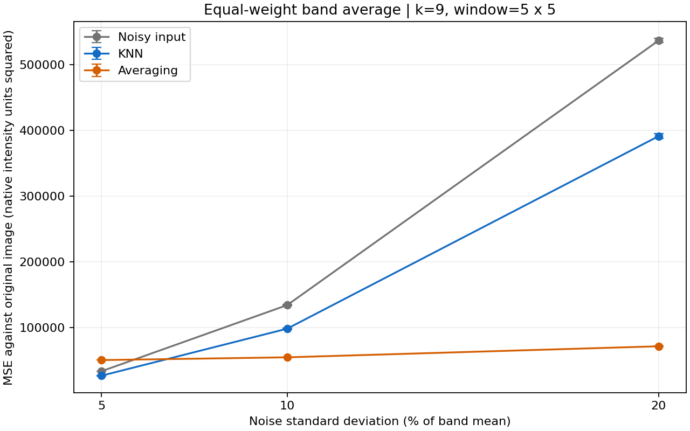

# GNR 607: uniform-noise removal using KNN and averaging

This project adds controlled uniform noise to remotely sensed image bands,
implements two spatial filters manually, and compares their reconstruction MSE
at 5%, 10%, and 20% noise. Python is used. All algorithm code is in `core.py`.

## Run

Clone the repository, then install the dependencies and run the experiment:

```powershell
git clone https://github.com/Ayush20990/gnr607-image-denoising.git
cd gnr607-image-denoising
python -m pip install -r requirements.txt
python run_project.py --k 9 --window 5 --trials 3
```

You can also choose **Code → Download ZIP** on GitHub, extract it, and open a
terminal in the extracted directory before running the last two commands.

To enter the window size and k interactively:

```powershell
python run_project.py
```

Open `results/report.html` in a browser after completion. A completed example
run is included, so you can inspect it before running anything.

The HTML report opens locally after cloning or downloading; GitHub displays
its source. The [MSE comparison graph](results/mse_comparison.png),
[example image panels](results/comparison_band_50.png), and
[numerical summary](results/summary.csv) can be viewed directly on GitHub.



## Working as a group

Create a branch for your changes and open a pull request to review them together.
Use a separate `--output` directory when trying new k or window values so that
the included reference results stay available. Repository write access must be
granted by the owner before a group member can push branches directly.

For example, after cloning:

```powershell
git switch -c experiment-k5
python run_project.py --k 5 --window 3 --output results_k5_3x3
```

## More run options

Other examples:

```powershell
python run_project.py --k 5 --window 3 --trials 3 --output results_3x3
python run_project.py --k 9 --window 5 --trials 10 --output results_10_trials
python run_project.py --image my_image.png --k 5 --window 3 --output my_results
python run_project.py --image data/Indian_pines_corrected.mat --bands 20 50 100 180 --k 9 --window 5
python -m unittest -v
```

For your own MAT image, provide `--mat-key VARIABLE_NAME`. Cubes must have
dimensions `(height, width, bands)`. Ordinary grayscale/RGB images are supported
through Pillow; arbitrary geospatial multiband TIFF layouts are not guaranteed.
All selected bands must contain finite values and have a positive mean.
No-data pixels must be removed or handled before supplying an image.
With a custom image, omitting `--bands` processes every band. Pure Python loops
are intentionally transparent but can be slow on large cubes. Different runs
overwrite the same output directory; use `--output` to retain comparisons.

## Data and reference

The example uses four bands (one-based indices **20, 50, 100, 180**) from the
145 × 145 × 200 corrected Indian Pines AVIRIS dataset. These are sampled across
the corrected spectral cube, which contains visible and infrared bands. They
are not an RGB photograph and were not selected to optimize the experiment's
MSE. The program processes bands independently; it does not implement spectral
vector KNN. Use all bands if your instructor requests the full cube.

- Dataset description and original downloads:
  <https://www.ehu.eus/ccwintco/index.php/Hyperspectral_Remote_Sensing_Scenes>
- Original data citation: Baumgardner, Biehl and Landgrebe (2015),
  *220 Band AVIRIS Hyperspectral Image Data Set: June 12, 1992 Indian Pine Test Site 3*,
  <https://doi.org/10.4231/R7RX991C>.
- Public download mirror, used when the university server rejects access:
  <https://huggingface.co/datasets/danaroth/indian_pines/tree/b96c10a>.
  The downloader pins this revision and verifies SHA-256 checksums.

Both the image cube and the land-cover label map are included in `data/`.
The label map is available for context and further coursework, but **is not
used as the MSE reference**. Class IDs are not radiometric pixel values.
The original image before synthetic noise is the denoising reference. It is
not claimed to be an intrinsically noise-free sensor measurement.

## Resolve the assignment's noise wording

The brief first says "noise equal to 10% of mean" and later specifies
"noise standard deviation = 5% and 20%." The consistent default is:

```text
mu_b = mean of original band b
sigma_b = p * mu_b, where p is 0.05, 0.10 or 0.20
a_b = sqrt(3) * sigma_b
n_b ~ Uniform(-a_b, +a_b)
Y_b = X_b + n_b
```

This follows from `Var[Uniform(-a,+a)] = a^2/3`. For a band with mean 100,
the 10% case has sigma 10 and bounds approximately ±17.3205.
Noise has theoretical mean zero. Finite samples have small nonzero means
and sample standard deviations near, rather than exactly equal to, the target.
Do not subtract the realized mean or force the sample variance: that changes
the sampling procedure. Do not clip or round before filtering or MSE.

If the instructor instead intends ±p times the mean as the uniform bounds:

```powershell
python run_project.py --k 9 --window 5 --noise-parameter half-width --output results_half_width
```

In that alternative run, the percentages describe **half-width**, not standard
deviation; the actual sigma is `p * mu_b / sqrt(3)`. Keep this distinction in
your submission. The main included experiment uses `std` throughout.

## Filters and MSE

For each band and output pixel:

1. Read the noisy values in the odd-sized `w × w` spatial window.
2. Replicate edge values for window locations outside the image.
3. KNN: compute squared intensity differences from the noisy centre, manually
   retain the k smallest, and average their values. The centre is eligible.
   Ties follow row-major traversal. Here "nearest" refers to **intensity**;
   the spatial window restricts the candidate pixels.
4. Averaging: average all `w²` candidates from that same window.
5. Compute `MSE = sum((original - filtered)^2) / (height * width)` manually.

Both filters receive exactly the same noisy image and use the same boundary
rule. Each output is computed from the unchanged noisy input, never from
partially filtered results. The MSE includes the border. The aggregate MSE is
the equal-weight mean of the per-band MSEs; all bands have the same dimensions.
MSE units are the square of the dataset's native intensity units.

**Useful limiting cases:** k = 1 returns the noisy image, while k = w² returns
the averaging-filter output. A 1 × 1 window with k = 1 is also the identity.

Three seeded repetitions are included. Noise streams change between trials
and bands; the same base realization is scaled across noise levels within a
trial and band. Results report the mean and sample SD across trials. This SD
describes run variability; it is not a confidence interval or statistical
significance claim. Increase `--trials` for a more stable comparison.

## Built-in function restrictions

`core.py` manually implements the pseudorandom generator (Park-Miller), noise
transformation, image means, standard deviations, boundary handling, nearest
selection, both filters and MSE using loops and scalar arithmetic. It does not
use library filtering, convolution, KNN, sorting, random-number generation,
mean, variance or MSE functions. List insertion is storage manipulation, not
a library sorting algorithm. Square roots use scalar exponentiation.

SciPy is used only to read/write MAT image files. Pillow reads ordinary images.
NumPy is used only to convert image storage into indexable arrays. Matplotlib
displays/saves figures. Python's standard libraries handle arguments, file
paths, downloads, checksums, CSV and HTML. No image-processing package performs
the assignment's numerical work.

## Outputs

| File | Contents |
| --- | --- |
| `results/report.html` | Method, measured comparison, discussion and image panels |
| `results/summary.csv` | MSE mean and trial SD at all three levels |
| `results/per_band_results.csv` | MSE and realized noise statistics for every band/trial |
| `results/per_trial_results.csv` | Aggregate MSE for every trial |
| `results/mse_comparison.png` | Comparison graph with trial-SD error bars |
| `results/comparison_band_*.png` | Original/noisy/KNN/average panels for trial 1 |
| `results/trial1_images.mat` | Full-precision original and processed trial-1 arrays |
| `results/run_metadata.json` | Parameters, band indices, dimensions and conventions |
| `data/source_manifest.json` | Download origins and checksums |

The saved panels use a common intensity scale within each band. Computational
arrays remain unclipped; display saturation is only a visualization effect.

## Included measured results

For k = 9, a 5 × 5 window, four selected bands and three trials:

| Noise SD / band mean | Noisy MSE | KNN MSE | Averaging MSE |
| --- | ---: | ---: | ---: |
| 5% | 33,532.25 | 26,760.79 | 50,508.23 |
| 10% | 134,129.01 | 98,267.84 | 54,714.77 |
| 20% | 536,516.05 | 391,083.67 | 71,479.32 |

These are mean aggregate MSEs, in native intensity units squared. KNN wins at
5%; averaging wins at 10% and 20%. At 5%, averaging actually increases MSE
relative to the noisy input: smoothing distortion exceeds the noise reduction.
Trial standard deviations and individual-band results are in the output files.
These conclusions apply to this dataset, band subset and parameter choice.

## Discussion points for your report or viva

- Averaging reduces noise in uniform regions but blurs boundaries.
- KNN may preserve boundaries better, but the noisy centre can select other
  similarly noisy pixels, limiting noise removal.
- Neither method is guaranteed to give the lower MSE for every scene or band.
- Smaller k is not automatically better, and higher k is not automatically
  better. k = w² removes any difference between the two methods.
- Native-unit aggregate MSE can be dominated by bands with larger absolute
  errors; inspect individual bands before generalizing.
- Land-cover labels and clean radiometric reference images serve different
  purposes. This experiment does not test classification accuracy.

The nine tests cover known PRNG outputs, hand-computed filtering and borders,
identity/full-window limits, constants, MSE, noise statistics and bounds,
reproducibility, absence of clipping, and parameter validation.
